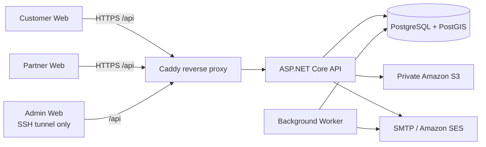

# SHUTTLEBOOK

> Nền tảng đặt sân thể thao kết nối khách hàng, chủ sân và quản trị viên trong một luồng đặt chỗ, báo chuyển khoản và xác nhận thanh toán.

[](https://nodejs.org/)
[](https://dotnet.microsoft.com/)
[](https://www.postgresql.org/)
[](https://www.docker.com/)
[](https://github.com/nguyendingluong20225878/ShuttleBook/actions/workflows/ci.yml)

## 📌 Tổng quan

Việc đặt sân thường diễn ra qua tin nhắn, bảng tính và xác nhận chuyển khoản thủ công. Điều đó dễ tạo lịch trùng, sai giá hoặc thiếu bằng chứng thanh toán. ShuttleBook quản lý quy trình này trên một nguồn dữ liệu thống nhất, từ tìm sân đến xác nhận booking.

### Tính năng chính

- **Ba portal theo vai trò:** Customer, Partner và Admin.
- **Khám phá sân:** tìm theo vị trí/bán kính, xem cơ sở, sân và thời gian còn trống.
- **Đặt sân vãng lai và cố định:** báo giá theo ca 30 phút, giữ chỗ và ngăn đặt trùng bằng PostgreSQL/PostGIS.
- **Vận hành sân:** chủ sân quản lý cơ sở, sân, lịch mở cửa, giá, giá đặc biệt, bảo trì và tài khoản nhận thanh toán.
- **Thanh toán chuyển khoản:** khách gửi bằng chứng, chủ sân đối chiếu và xác nhận hoặc từ chối.
- **Thông báo tin cậy:** dùng transactional outbox để gửi và retry theo hướng idempotent.
- **Quản trị:** Admin duyệt hồ sơ/cập nhật của đối tác và theo dõi thông báo quản trị.
- **Bảo mật phiên:** OTP, JWT/refresh session, kiểm tra scope ở backend, rate limit và private media qua presigned URL.

## 🧪 Closed pilot (AWS staging)

Môi trường staging hiện dành cho nhóm thử nghiệm nhỏ, khoảng 5–10 tài khoản.

| Portal | Địa chỉ thử |
|---|---|
| Customer | <https://shuttlebook-ndl2510.duckdns.org> |
| Partner | <https://shuttlebook-partner-ndl2510.duckdns.org> |

- Hai hostname dùng DuckDNS, được EC2 tự cập nhật khi Public IPv4 thay đổi và phục vụ qua HTTPS.
- Admin không công khai; chỉ truy cập qua SSH tunnel.
- OTP hiện dùng **Amazon SES Sandbox** ở Region Singapore. Chỉ email đã được xác minh trong SES mới nhận OTP. Hãy verify email của người thử trước khi mời họ.

> Đây là closed pilot, chưa phải môi trường production mở cho mọi người dùng.

## 🛠 Công nghệ sử dụng

| Nhóm | Công nghệ |
|---|---|
| Frontend | React 19, TypeScript, Vite 8, workspace UI dùng chung |
| Backend | ASP.NET Core Minimal API, .NET 10, Background Worker, Admin CLI |
| Database | PostgreSQL 17, PostGIS, Entity Framework Core, Npgsql |
| Authentication | ASP.NET Core Identity primitives, JWT Bearer, cookie browser session, OTP qua SMTP |
| Media | Amazon S3 private, presigned URL, AWS SDK for .NET |
| Local development | Docker Compose, Mailpit |
| Testing | xUnit, PostgreSQL/PostGIS integration tests, Playwright |
| CI | GitHub Actions |
| Staging | Amazon EC2, Docker Compose, Caddy, Let’s Encrypt, DuckDNS, Amazon SES |

## 🏗 Kiến trúc



EC2 chạy Docker cho Web, API, Worker và PostgreSQL/PostGIS. Dữ liệu PostgreSQL nằm trong Docker volume trên EBS; ảnh và bằng chứng thanh toán nằm trong S3 private, chỉ truy cập qua quyền AWS và presigned URL.

### Cấu trúc thư mục

```text
ShuttleBook/
├── apps/
│   ├── customer-web/          # React portal cho khách đặt sân
│   ├── partner-web/           # React portal cho chủ sân
│   └── admin-web/             # React portal quản trị
├── packages/
│   └── ui/                    # Thành phần UI dùng chung
├── backend/
│   ├── src/
│   │   ├── ShuttleBook.Api/            # Minimal API và endpoint nghiệp vụ
│   │   ├── ShuttleBook.Infrastructure/ # EF Core, PostGIS, domain services
│   │   ├── ShuttleBook.Worker/         # Xử lý outbox nền
│   │   ├── ShuttleBook.Migrator/       # Áp dụng migration database
│   │   └── ShuttleBook.AdminCli/       # Bootstrap và thao tác Admin
│   └── tests/                  # API và integration test với PostgreSQL thật
├── deploy/                     # Dockerfile, Compose và cấu hình staging mẫu
├── scripts/                    # Script PowerShell cho setup, chạy và test
├── tests/web/                  # Playwright browser tests
├── compose.yaml                # PostgreSQL/PostGIS và Mailpit cho local
└── .env.example                # Mẫu cấu hình local, không chứa secret
```

## 🚀 Bắt đầu nhanh

### Điều kiện tiên quyết

- Git
- Windows PowerShell 5.1 hoặc PowerShell 7
- Node.js `22.12+` trong nhánh 22 hoặc Node.js 24
- Docker Desktop đang chạy, gồm Docker Compose v2
- .NET SDK `10.0.401` (script bên dưới có thể cài SDK riêng cho dự án)

### Cài đặt

```powershell
git clone https://github.com/nguyendingluong20225878/ShuttleBook.git
cd ShuttleBook

powershell.exe -NoProfile -ExecutionPolicy Bypass -File .\scripts\Initialize-Local.ps1
powershell.exe -NoProfile -ExecutionPolicy Bypass -File .\scripts\Install-DotNet.ps1
npm.cmd ci

powershell.exe -NoProfile -ExecutionPolicy Bypass -File .\scripts\Doctor.ps1
```

`Initialize-Local.ps1` tạo `.env` bị Git bỏ qua và sinh secret local ngẫu nhiên. Không sao chép `.env` vào repository, issue, log hoặc ảnh chụp màn hình.

### Biến môi trường

Sao chép từ `.env.example` cho local. Script khởi tạo thường đã tạo sẵn `.env`.

| Biến | Mục đích |
|---|---|
| `POSTGRES_DB`, `POSTGRES_USER`, `POSTGRES_PASSWORD`, `POSTGRES_PORT` | Kết nối PostgreSQL local qua Docker Compose |
| `IDENTITY_OTP_PEPPER`, `IDENTITY_JWT_SIGNING_KEY` | Secret local cho OTP và ký JWT |
| `ASPNETCORE_ENVIRONMENT`, `DOTNET_ENVIRONMENT`, `ASPNETCORE_URLS` | Môi trường và URL lắng nghe của API |
| `VITE_API_BASE_URL` | API base URL khi chạy frontend local |
| `VITE_MAPTILER_API_KEY` | API key trình duyệt cho bản đồ, nếu cần dùng bản đồ |
| `BrowserSession__CustomerOrigin`, `BrowserSession__PartnerOrigin`, `AdminSession__AllowedOrigin` | Origin hợp lệ của ba portal |
| `Media__Mode` | `Local` cho máy cá nhân hoặc `S3` khi dùng private bucket |
| `Booking__QuoteSeconds`, `Booking__MaxAdvanceDays` | Thời hạn báo giá và giới hạn ngày đặt trước |
| `Outbox__AlertAttempts` | Số lần retry cảnh báo outbox |

Các biến SMTP/SES, S3 và CORS được chú thích trong `.env.example`. Chỉ điền chúng vào file `.env` hoặc `.env.staging` bị Git bỏ qua; không đặt credentials thật trong mã nguồn.

### Khởi động local

Mở PostgreSQL/PostGIS và Mailpit:

```powershell
npm.cmd run db:up
npm.cmd run db:migrate
```

Sau đó mở năm cửa sổ PowerShell tại root dự án:

```powershell
npm.cmd run dev:api
npm.cmd run dev:worker
npm.cmd run dev:customer
npm.cmd run dev:partner
npm.cmd run dev:admin
```

| Thành phần | Địa chỉ local |
|---|---|
| Customer | <http://localhost:5173> |
| Partner | <http://localhost:5174> |
| Admin | <http://localhost:5175> |
| API | <http://localhost:5080> |
| Mailpit | <http://localhost:8025> |

Ở local, OTP xuất hiện trong Mailpit; không cần SES hay email thật. Để tạo Admin local, chạy:

```powershell
npm.cmd run admin:bootstrap
```

### Chạy bằng Docker

`compose.yaml` phục vụ **hạ tầng local** gồm PostgreSQL/PostGIS và Mailpit. API, Worker và các frontend chạy qua các script `npm` ở trên.

```powershell
docker compose up -d --wait
docker compose ps
```

Cho staging Linux, dùng `deploy/compose.staging.yml` cùng `.env.staging` riêng tư tạo từ `deploy/staging.env.example`. Không commit `.env.staging`, PFX/PEM, backup database hoặc cấu hình hạ tầng theo máy chủ.

## 📖 Sử dụng và API

### Luồng sử dụng cơ bản

1. Customer đăng ký, xác minh OTP, tìm sân, nhận báo giá và tạo booking.
2. Customer báo đã chuyển khoản và tải bằng chứng thanh toán lên private storage.
3. Partner tạo hồ sơ cơ sở/sân, cấu hình lịch, giá và xác nhận hoặc từ chối thanh toán.
4. Admin duyệt hồ sơ hoặc yêu cầu chỉnh sửa trước khi cơ sở được public.

### API tiêu biểu

API hiện chưa công bố Swagger/OpenAPI UI. Các endpoint dưới đây là nhóm route quan trọng; request/response chi tiết nằm trong source và test.

| Method | Route | Mô tả |
|---|---|---|
| `GET` | `/health/live` | Kiểm tra tiến trình API sống |
| `GET` | `/health/ready` | Kiểm tra API sẵn sàng, gồm database |
| `POST` | `/api/v1/auth/register` | Đăng ký Customer |
| `POST` | `/api/v1/auth/verify-contact` | Xác minh contact Customer bằng OTP |
| `POST` | `/api/v1/partner-auth/register` | Đăng ký Partner |
| `POST` | `/api/v1/auth/login` | Đăng nhập qua JWT API |
| `GET` | `/api/v1/venues/nearby` | Tìm sân theo vị trí và bán kính |
| `POST` | `/api/v1/availability/quote` | Lấy báo giá booking vãng lai |
| `POST` | `/api/v1/bookings` | Tạo booking vãng lai |
| `POST` | `/api/v1/booking-series` | Tạo booking cố định theo kỳ |
| `POST` | `/api/v1/bookings/{id}/transfer-evidence` | Báo đã chuyển khoản |
| `POST` | `/api/v1/operator/bookings/{id}/confirm-payment` | Partner xác nhận thanh toán |
| `GET` | `/api/v1/me/notifications/` | Lấy thông báo của người dùng hiện tại |

Các endpoint có dữ liệu người dùng yêu cầu xác thực và kiểm tra quyền/scope ở backend.

## 🧪 Kiểm thử

```powershell
# TypeScript
npm.cmd run typecheck

# Build ba frontend
npm.cmd run build

# API unit/integration tests
npm.cmd run test:api

# PostgreSQL/PostGIS integration tests (Docker phải đang chạy)
npm.cmd run test:db

# Cài Chromium cho Playwright, chỉ cần một lần trên mỗi máy
npm.cmd run setup:browsers

# Browser tests
npm.cmd run test:web
```

CI GitHub Actions chạy typecheck, build, Playwright, migration lặp lại an toàn, API tests, database tests và kiểm tra đóng gói staging.

## 🤝 Đóng góp

1. Fork repository và tạo branch mô tả rõ thay đổi.
2. Giữ thay đổi trong phạm vi một vấn đề; không đưa secret, dữ liệu cá nhân hoặc output sinh tự động vào commit.
3. Chạy các lệnh test phù hợp trong mục **Kiểm thử**.
4. Mở Pull Request, mô tả mục tiêu, cách kiểm tra và rủi ro còn lại.

Repository chưa quy định commit convention riêng. Hãy dùng message ngắn, dạng mệnh lệnh và nêu rõ phạm vi, ví dụ `fix: validate payment evidence upload`.

## 📄 Giấy phép

Repository hiện **chưa có file LICENSE**. Không tự suy diễn quyền sử dụng, phân phối hoặc đóng góp ngoài những gì chủ repository cho phép.


